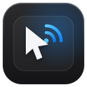

<div align="center">



# RemotePC+

**Wireless trackpad, multi-monitor controller, and media remote for Windows.**

[](https://github.com/semih-aydin/RemotePC-Plus/releases/latest)
[](https://github.com/semih-aydin/RemotePC-Plus/actions/workflows/build-apk.yml)
[](LICENSE)

</div>

---

## Download

| Platform | Package | Requirements |
| :--- | :--- | :--- |
| **Windows** | [`RemotePC-Plus-Windows.zip`](https://github.com/semih-aydin/RemotePC-Plus/releases/latest) | Windows 10 / 11 (x64) |
| **Android** | [`RemotePC-Plus-Android.apk`](https://github.com/semih-aydin/RemotePC-Plus/releases/latest) | Android 7.0+ |

### Setup

1. **Windows:** Extract `RemotePC-Plus-Windows.zip` and launch `RemotePCPlus.exe`. The app runs in the system tray; double-click the tray icon to open the Control Center.
2. **Android:** Install `RemotePC-Plus-Android.apk` and open it on the same Wi-Fi network. Your PC is discovered automatically via LAN broadcast.

> **Firewall:** On first launch, use **Tray Menu → Güvenlik Duvarını Ayarla** to allow TCP `5000`/`5443` and UDP `5055`.

---

## Capabilities

- **Precision Trackpad** — 120Hz native touch input, velocity-based acceleration, tap-to-click, double-tap drag, two-finger scroll/zoom/right-click, and three-finger middle-click & display switching.
- **Multi-Monitor Engine** — Automatic Win32 display layout detection, per-display DPI profiles, instant display jump, and boundary magnetism.
- **Media & Presentation Remote** — Playback, volume, slide navigation, hardware volume key mapping, and quick desktop shortcuts.
- **Native Windows Integration** — Direct Win32 FFI (`user32`, `gdi32`, `kernel32`) with full Unicode/Turkish keyboard support (`SendInput`), real-time cursor magnifier, and a lightweight 26 KB system tray app.
- **Local-First Security** — Admin panel restricted to `localhost`, optional PIN authentication with rate limiting, and zero cloud dependency.

---

## Architecture

```text
RemotePC-Plus/
├── android/                  # Native Kotlin Android client
├── tray/                     # Windows System Tray app (C# / WinForms) & app.ico
├── public/                   # Web/PWA client & Desktop Control Center
├── scripts/                  # Firewall & tray build utilities
├── server.js                 # HTTP/HTTPS, WebSocket & UDP discovery server
├── win32_api.js              # Win32 FFI input & screen capture layer
├── monitor_manager.js        # Multi-monitor layout, DPI & boundary engine
├── app_detector.js           # Active window context detector
└── test_integration.js       # Integration test suite
```

---

## Building from Source

Requires **Windows 10/11** and **Node.js 18+**.

```bash
git clone https://github.com/semih-aydin/RemotePC-Plus.git
cd RemotePC-Plus
npm install
npm start
```

```bash
npm test            # Run Win32 & multi-monitor integration tests
npm run build:tray  # Rebuild RemotePCPlus.exe
```

---

## License

MIT — Semih Aydın
